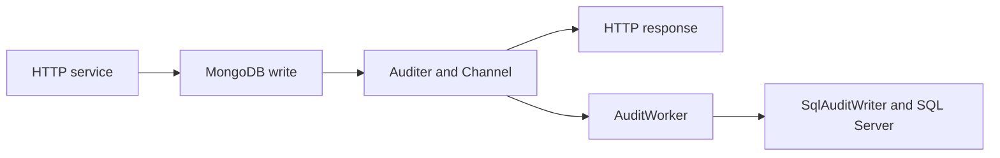

# Architecture

## Overview

The API stays in one .NET 10 project. Dependencies flow from controllers to
application services, then to repositories and auditing. API and persistence
models remain shared; MongoDB mappings and SQL migrations are unchanged.

## Responsibilities

| Component | Responsibility |
| --- | --- |
| `Claims/Controllers` | HTTP binding and successful responses through service interfaces. |
| `Claims/Services` | Business validation, existence checks, ID generation, premium calculation, and audit ordering. |
| `PremiumCalculator` | Arithmetic only; the legacy algorithm is unchanged. |
| `Claims/Repositories` | Focused claim and cover queries and writes, including direct ID lookups. |
| `Claims/Data/ClaimsContext.cs` | Existing MongoDB collection mappings. |
| `Claims/Auditing` | `IAuditer` publishes events; `AuditWorker` and scoped `SqlAuditWriter` persist them through `AuditContext`. |
| `Claims/Filters` | Translate business validation and missing-resource exceptions into HTTP responses. |
| `Claims/Serialization` | UTC JSON parsing for claim and cover dates. |
| `Claims/ModelBinding` | UTC parsing for the premium endpoint's query dates. |
| `Claims/Program.cs` | Dependency registration and application startup. |

## Dependency injection

Application services, repositories, and `ClaimsContext` are scoped to requests.
`Auditer`, `AuditQueue`, the hosted worker, the stateless premium calculator, and
`TimeProvider.System` are singletons. `IAuditWriter` and `AuditContext` are scoped;
the worker creates a fresh async scope for each processing attempt. The publisher
has no database dependency. Producers and the worker resolve the same queue.
Cover validation reads the UTC date through `TimeProvider`; tests use a fixed clock.

Interfaces allow small test fakes without databases. There is no generic
repository, additional unit-of-work abstraction, or separate project per layer.
Service-level validation uses ordinary checks, without a validation package.

## Claim validation

Before changing the submitted object, assigning an ID, saving, or auditing,
`ClaimService` checks:

- `DamageCost` is between 0 and 100000, inclusive.
- `CoverId` is not blank and identifies an existing cover.
- The normalized `Created` timestamp is between the cover's normalized
  `StartDate` and `EndDate`, including both boundaries.

A missing referenced cover is a 400 field error on `coverId`, because the claim
submission contains an invalid reference. It is distinct from requesting a missing
resource by its own URL. Claim dates are not independently checked against now.

## Cover validation

Creation and premium quoting share `CoverService.ValidatePeriod`:

- `StartDate` must not precede today's UTC date. Any time today is accepted,
  including a time earlier than the current time.
- `EndDate` must be strictly after `StartDate`.
- `EndDate` must not exceed `StartDate.AddYears(1)`, preserving the time of day.

One calendar year can span 366 days. February 29, 2032 maps to February 28, 2033
under `AddYears(1)`. One tick beyond the anniversary is rejected. Year 9999 is
handled without overflowing `AddYears`; representable later dates in that year
cannot exceed a full calendar year.

Validation completes before premium calculation or changes to the submitted cover.
Invalid creation leaves its ID, dates, and premium unchanged and does not save or
audit. Invalid quotes do not invoke the calculator, save, or audit.

## UTC contract

- JSON dates use ISO 8601. Explicit offsets are converted to the same UTC instant;
  date-only and timezone-free values are interpreted as UTC.
- Compute query dates use invariant .NET parsing with `AssumeUniversal`, then
  convert to UTC. Encode a positive offset's `+` as `%2B` in a URL.
- Services accept `DateTimeKind.Utc` and treat `Unspecified` as UTC. They reject
  `Local` values rather than using the server's timezone. JSON and query parsing
  normalize explicit offsets before calling services.
- Successfully created claim and cover dates are stored as UTC. Existing cover
  dates are normalized for comparison without modifying the retrieved cover.
- Coverage boundaries are exact timestamps. An `EndDate` at midnight does not
  imply coverage through the remainder of that calendar day.

For example, `2030-01-01T02:00:00+02:00` and
`2030-01-01T00:00:00Z` are equivalent. UTC conversion happens before validation,
so a wall-clock date of today can still normalize to yesterday and be rejected.

## HTTP errors and operation order

`BusinessValidationException` carries field errors without HTTP dependencies.
`ValidationExceptionFilter` returns 400 `ValidationProblemDetails` with
`application/problem+json`:

```json
{
  "title": "One or more validation errors occurred.",
  "status": 400,
  "errors": {
    "damageCost": ["DamageCost must be between 0 and 100000, inclusive."]
  }
}
```

Malformed JSON/query dates and framework model-validation failures also return
400 validation problem details through `[ApiController]`. Business errors use
camel-case field keys; framework errors may use CLR property names or JSON paths.
The exact framework error text is not part of the application contract.

Service lookups throw `ResourceNotFoundException` when a claim or cover does not
exist. `ResourceNotFoundExceptionFilter` returns 404 `ProblemDetails`:

```json
{
  "title": "Resource not found.",
  "status": 404,
  "detail": "Claim 'missing' was not found."
}
```

| Operation | Successful response | Missing or invalid input |
| --- | --- | --- |
| GET collection | 200 with an array, including `[]` | Empty collections are not 404. |
| GET by ID | 200 with the entity | 404 if missing. |
| POST creation | 200 with server-generated ID and created entity | 400 for validation failure. |
| POST premium compute | 200 with a decimal premium | 400 for invalid dates or period. |
| DELETE by ID | 200 with an empty body | 404 if missing. |

Valid creates save, then await audit enqueueing; cover creation replaces the
submitted premium. Deletes check existence, await deletion, then await audit
enqueueing. This deliberately replaces the original audit-before-delete order:
a failed MongoDB deletion must not publish a successful DELETE event. Invalid
creates, missing resources, and failed MongoDB writes do not publish events.
Reads and premium computation are not audited. Repeated DELETE returns 404 after
the first successful deletion.

A successful mutation response means the MongoDB operation completed and its audit
event was accepted into memory, not that SQL persistence finished. Unexpected
infrastructure failures, including enqueueing to a closed queue after a MongoDB
write, are not translated to 400 or 404. There is no automatic rollback.

## Asynchronous auditing



`Auditer` creates an immutable `AuditEvent` containing entity type, ID, POST/DELETE
label, and creation timestamp, then awaits queue acceptance. No request-scoped
context, HTTP object, or executable delegate is queued. There is no fire-and-forget
`Task.Run` in application code.

The bounded `Channel<AuditEvent>` holds 1000 events with `SingleReader = true`,
`SingleWriter = false`, and `FullMode = Wait`. Multiple producers can publish
safely; the single worker awaits each event before moving on. A full queue waits
asynchronously for capacity rather than dropping events or growing without bound.
Consequently a saturated queue can delay HTTP requests even though SQL writes are
outside their execution flow. Processing follows enqueue order, not a global
ordering of concurrent MongoDB operations or different application instances.

Audit timestamps retain the existing local wall-clock convention, separately from
the UTC claim/cover date contract. `TimeProvider.GetLocalNow().DateTime` captures
the timestamp when publication begins, before waiting for queue space. The worker
does not replace it with processing time. SQL `datetime2` stores that wall-clock
value without an offset; audit timestamps can be ambiguous across timezone/DST
changes. Switching audit history to UTC would be a separate decision.

For every attempt the worker creates an async DI scope, resolves `IAuditWriter`,
and disposes the scope before retrying or reading another event. `SqlAuditWriter`
adds a `ClaimAudit` or `CoverAudit` and awaits `SaveChangesAsync` with cancellation.
Both POST and DELETE labels produce INSERTs; DELETE does not remove audit history.
Existing tables, field mappings, and migrations are unchanged.

Each event has at most three attempts. The worker waits 1 second after the first
failure and 2 seconds after the second; delays are cancellable. Logs carry the
entity type, ID, operation, creation timestamp, exception, and attempt number.
After the third failure it logs an error, abandons the event, and continues with
the next one. There is no persistent failed-event store or exactly-once guarantee.

During `StopAsync`, queue completion rejects new events while the worker attempts
to drain accepted events. Normal stopping does not immediately cancel SQL writes.
The host supplies a shutdown deadline; once its token is cancelled, processing
and retry delays are cancelled. A separate worker cancellation source allows
normal draining without ignoring the deadline. The worker waits for draining before
calling `base.StopAsync`: .NET 10 can otherwise cancel a scheduled `ExecuteAsync`
before it starts. A final cancellation check also covers the race where the
deadline wait finishes before its cancellation callback.

If SQL Server is unavailable during shutdown, retries continue only while the
shutdown budget permits. Events can exhaust retries and be abandoned, or the
deadline can interrupt an attempt/delay and leave the backlog unprocessed. SQL
cancellation is cooperative; an unresponsive provider cannot be forcibly stopped.
Forced termination loses remaining in-memory events. Logs report interrupted
draining and individual write failures.

Services do not tie post-write audit publication to HTTP request cancellation:
a disconnected client should not by itself discard an audit after MongoDB changed.
Queue closure during shutdown can still reject publication after that change.

## Current premium calculation

The calculator preserves the legacy algorithm, including its defects:

- The base daily rate is 1250 with multipliers: Yacht 1.1, PassengerShip 1.2,
  Tanker 1.5, and other types 1.3.
- Conditions overlap: the first 30 days receive three charges per day, days
  31–180 receive two, and days 181–365 receive one.
- Overlapping discounted charges use 5% and 8% for yachts, and 2% and 3% otherwise.
- Partial days round up; days after day 365 add no premium.
- Direct calculator calls for zero-length or reversed periods return zero, but
  the service/API now reject such periods before calling it.

A one-day yacht cover currently returns 3946.25; the assignment's correct value
is 1375. Characterization tests preserve the current results until Task 5.

## Testing strategy

The xUnit project uses fake repositories, recording publishers, controlled writers,
and a fixed `TimeProvider`. Tests cover validation boundaries, leap years, UTC
midnight, normalization, missing resources, ID generation, premium assignment,
operation ordering, queue capacity/cancellation/completion, retries, scope isolation,
and shutdown deadlines. Invalid-operation tests verify no persistence or publication.
Premium characterization tests retain current totals and known defects.

Docker-free HTTP tests use real ASP.NET Core controllers, binding, filters,
services, and JSON formatting. `HttpAuditIntegrationTests` also runs the real
publisher, queue, and hosted worker with fake repositories and a controlled writer.
The writer signals that processing started, then waits on a `TaskCompletionSource`.
The test verifies that POST/DELETE HTTP responses complete before releasing it,
then waits for processing completion. No timing-based sleeps are used. This host
mirrors relevant production registrations, avoiding `Program.cs` and its Docker
startup. It does not exercise every production middleware component.

`SqlAuditWriterTests` checks EF Added states, field/table mappings, async completion,
and cancellation using a test context that never opens a connection.
`AuditPersistenceTests` separately starts a real SQL Server through the existing
Testcontainers package and image policy, applies the existing migrations, and runs
the real publisher/queue/worker/writer registrations. It publishes Claim POST/DELETE
and Cover POST/DELETE, drains accepted events through graceful shutdown, then
asserts two distinct rows per entity table with exact IDs, labels, and timestamps.
This checks real SQL persistence and retained history without polling. It isolates
auditing and does not execute MongoDB CRUD.

The original `ClaimsControllerTests` smoke test starts `Program.cs`, including its
SQL Server and MongoDB containers, and checks that `GET /Claims` succeeds. No new
package or test framework was added.

Run Docker-free tests from the repository root:

```sh
dotnet test --no-restore --filter-class 'Claims.Tests.Unit.*'
```

Run both Docker-backed test classes:

```sh
dotnet test --no-restore --filter-class 'Claims.Tests.Integration.*' --filter-class Claims.Tests.ClaimsControllerTests
```

Run all tests with `dotnet test --no-restore`. Docker-backed tests require a running
Docker daemon and access to the container images. The SQL persistence test uses
an isolated container and disposes it on completion. See the
[project README](../README.md) for setup and build commands.

## Known limitations and trade-offs

- Auditing is best-effort and eventually persisted. A crash between MongoDB and
  enqueueing, a crash with queued events, exhausted retries, or a shutdown deadline
  can lose an audit. Successful HTTP responses do not guarantee a SQL row exists.
- A retry after an ambiguous SQL commit can insert duplicates. There is no durable
  outbox, replay store, or idempotency constraint. An enqueue failure does not undo
  MongoDB changes. Each API instance has its own in-memory queue.
- Premium defects remain for Task 5.
- Existence checks and writes are separate operations. Concurrent cover deletion
  can race with claim creation; concurrent resource deletion can race with the
  pre-delete check. MongoDB and SQL Server have no shared transaction. Cover
  references are checked at creation; deleting a cover does not cascade to claims.
- DELETE performs both a service existence lookup and the repository's existing
  lookup to preserve repository contracts.
- Shared non-nullable string models retain ASP.NET Core's implicit required-field
  validation. Create bodies still need an `id` value, even though the service
  replaces it; claims also require `name`. Introducing create-specific DTOs is
  outside this change.
- Query parsing accepts more invariant .NET date formats than JSON. Clients should
  send complete ISO 8601 dates/timestamps, rather than partial time-only inputs.
- SQL integration tests verify real audit writes; MongoDB mutation flows still
  use fakes in HTTP tests. The application smoke test covers claims-list access,
  not complete cross-database consistency, concurrent writes, or crash recovery.
- In-memory HTTP tests mirror relevant production registrations and settings;
  only the original Docker smoke test runs the full production startup.
